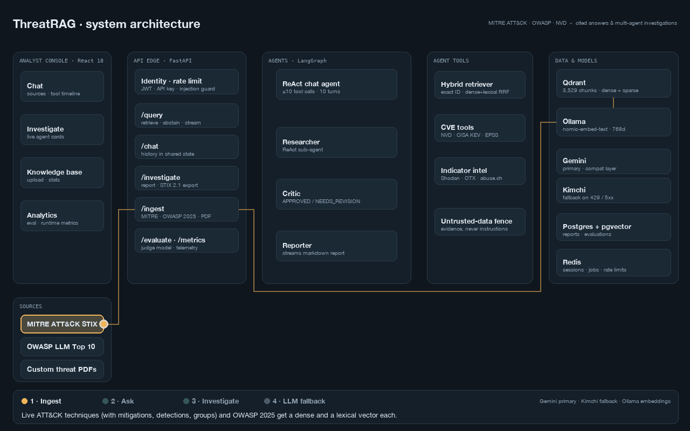

# ThreatRAG

Retrieval-augmented threat intelligence for SOC analysts: cited answers over MITRE ATT&CK and
the OWASP LLM Top 10, a tool-using chat agent, and a Researcher → Critic → Reporter
investigation pipeline that turns an indicator (CVE, IP, domain, hash) into a structured report.



## What it does

| Capability | How |
|---|---|
| Cited Q&A | Hybrid retrieval (dense + lexical + exact ID lookup) over MITRE ATT&CK and the OWASP LLM Top 10 2025, streamed over SSE; abstains when nothing relevant is found |
| Agentic chat | LangGraph ReAct agent, 10-turn memory, capped tool calls, live tool timeline |
| IOC investigation | LangGraph Researcher → Critic → Reporter with a revision loop and streamed report |
| Enrichment tools | NVD, CISA KEV, FIRST EPSS, Shodan InternetDB, AbuseIPDB, OTX, abuse.ch, web search |
| Report memory | Reports stored in PostgreSQL + pgvector; similar past investigations surfaced |
| Evaluation | Offline golden-set harness (hit@k, MRR, faithfulness, abstention) plus per-answer LLM-judge scoring with a separate judge model |
| Guardrails | Scored injection guard with optional LLM classifier, fenced tool output, IOC-safe secret redaction |
| Observability | Per-route latency, token and guard telemetry at `/api/v1/metrics` and on the Analytics page; optional Langfuse tracing |
| Resilience | Provider fallback (Gemini → Kimchi) that never switches mid-stream |

## Quickstart

Requires Docker, Python 3.13 and Node 20.

```bash
# 1. Infrastructure: Qdrant, Postgres (pgvector), Ollama
docker compose -f threatrag/infra/docker-compose.yml up -d qdrant postgres ollama
docker compose -f threatrag/infra/docker-compose.yml exec ollama ollama pull nomic-embed-text

# 2. Backend
cd threatrag/backend
python -m venv .venv && source .venv/bin/activate
pip install -r requirements.txt -r requirements-dev.txt
cp .env.example .env            # set GEMINI_API_KEY (or KIMCHI_API_KEY)
uvicorn app.main:app --reload --port 8000

# 3. Load the knowledge base (downloads MITRE ATT&CK and the OWASP LLM Top 10 2025 on first run)
python -m app.scripts.ingest_all

# 4. Frontend
cd ../web && npm install && npm run dev      # http://localhost:5173
```

API docs with runnable examples: http://localhost:8000/docs.
`./start-services.sh` does steps 1–4 with health checks; see [docs/run-commands.md](docs/run-commands.md).

## Architecture

```
React 18 (Vite, Tailwind)  ──SSE/REST──▶  FastAPI
                                            ├─ /query        ThreatRAGChain (retrieve → prompt → stream)
                                            ├─ /chat         ReAct agent + session memory
                                            ├─ /investigate  LangGraph: Researcher → Critic → Reporter
                                            ├─ /ingest       MITRE STIX, OWASP PDF, custom PDF upload
                                            └─ /evaluate     LLM-judge metrics + history
                                                 │
        Qdrant (vectors) · Ollama nomic-embed-text (embeddings) · PostgreSQL + pgvector (reports)
        Gemini → Kimchi (LLM, OpenAI-compatible) · NVD / KEV / EPSS / Shodan / OTX / abuse.ch (tools)
```

A fuller map with the request flows is in [docs/architecture.html](docs/architecture.html).

## Results

Measured on a 64-question golden set (`threatrag/backend/eval/golden.jsonl`): technique-ID
lookups, name lookups, behavioural paraphrases, OWASP questions and unanswerable questions.
Reproduce with `make -C threatrag eval LABEL=mine ANSWERS=20`.

| Retrieval configuration | hit@1 | hit@3 | hit@6 | MRR | ID lookup hit@6 |
|---|---|---|---|---|---|
| Phase 1 baseline (dense only) | 0.45 | 0.73 | 0.79 | 0.58 | 0.00 |
| Richer corpus, dense only | 0.57 | 0.68 | 0.71 | 0.63 | 0.00 |
| + lexical fusion (hybrid) | 0.68 | 0.88 | 0.95 | 0.79 | 1.00 |
| + exact identifier lookup (**default**) | 0.86 | 0.91 | 0.95 | 0.89 | 1.00 |
| + cross-encoder rerank (opt-in) | 0.89 | 0.96 | 0.98 | 0.93 | 1.00 |

What the numbers say:

- Dense embeddings could not find `T1110.003` by its ID at all. Lexical fusion fixed recall;
  exact lookup then put the right technique first.
- Adding mitigations, detections and groups made dense-only retrieval *worse* (0.79 → 0.71)
  because one technique's sections crowd the context. Fusion plus a two-chunk cap per
  technique recovered it.
- Reranking is opt-in: +0.03 hit@6 for about 1.1 s per query on CPU (1,190 ms vs 82 ms).

**Answers** (20 stratified questions; generator `gemini-3.5-flash-lite`, judge `gemini-3.1-flash-lite`):

| Pipeline | Faithfulness | Citation rate | Technique-ID accuracy | Correct abstention | False abstention |
|---|---|---|---|---|---|
| Phase 1 baseline | 1.00 | 1.00 | 0.88 | 1.00 | 0.25 |
| Hybrid + exact (default) | 0.99 | 0.88 | 0.92 | 1.00 | 0.00 |

The baseline stayed faithful by refusing a quarter of answerable questions. The current
pipeline answers all of them; two answers came back without a citation tag, which is the next
prompt fix.

**Prompt-injection guard** (`eval/injection_suite.jsonl`, 45 attacks and 45 benign security
questions; the held-out half was written after the rules were frozen):

| Mode | Held-out block rate | Held-out false positives |
|---|---|---|
| Patterns only (`GUARD_MODE=heuristic`, default) | 0.65 | 0.00 |
| Patterns + LLM classifier (`GUARD_MODE=llm`) | 0.95 | 0.00 |

Patterns are free and never block a legitimate security question in the suite, but paraphrased
attacks get past them. The classifier closes most of that gap for one extra small model call.

Raw per-question rows for every run are in `threatrag/backend/eval/results/`.

## Design decisions

- **One LLM construction point.** `app/core/llm.py` builds every chat model. The fallback is a
  `ChatOpenAI` subclass rather than `.with_fallbacks()` so `bind_tools()` still works for the
  ReAct agent, and it refuses to switch providers once tokens have streamed.
- **Deterministic citations.** The Researcher's sources come from a direct retrieval, not from
  whatever the model chose to call, so every report carries evidence.
- **Technique validation.** Reports are checked against the ingested ATT&CK corpus; a wrong
  ID/name pairing is annotated rather than silently shipped.
- **Retrieval is one component.** `app/rag/retriever.py` does exact identifier lookup,
  reciprocal-rank fusion of dense and lexical candidates, an optional cross-encoder rerank, a
  per-technique diversity cap, and abstention. Lexical vectors are computed in-process and
  Qdrant applies IDF, so there is no second index to keep in sync.
- **Measured, not assumed.** Every retrieval switch is an env var, so the ablation above is
  four runs of one command.
- **Guardrails that know the domain.** Analysts ask about "system prompt leakage" and "ignore
  previous instructions" payloads, so the guard scores whether text *addresses the assistant*,
  not whether it contains scary words. Tool and feed output is fenced as `<untrusted_data>`
  before the model sees it. The output sanitiser redacts credential formats but leaves emails,
  hashes and attacker passwords alone, because in threat intelligence those are the evidence.
- **Provider quirks live in one file.** `app/core/gemini_compat.py` replays Gemini's tool-call
  thought signatures and converts cumulative streaming usage to deltas (uncorrected, token
  counts were about 13× too high).
- **Telemetry without a vendor.** `GET /api/v1/metrics` reports per-route p50/p95, LLM tokens
  and guard/abstention counters from the process itself; Langfuse is added when keys are set.
- **Idempotent ingestion.** Point IDs are `uuid5` of the source key; re-ingesting overwrites.
  Points are tagged with their embedding model and mixing vector spaces is refused at startup.
- **Readiness that tells the truth.** `/health/ready` runs a one-token completion, because a
  provider can list models while refusing every request.
- **Small files.** Every source file is ≤ 150 lines with one responsibility.

## Quality gates

```bash
cd threatrag/backend
ruff check app/ && mypy app/ && pytest tests/unit --cov=app --cov-fail-under=80
cd ../web && npm run lint && npm run typecheck && npm run build
```

CI (`.github/workflows/ci.yml`) runs the same gates plus Docker builds and a Trivy scan.

## Known limits

Tracked with their fixes in [spec/phase5-9-plan.md](spec/phase5-9-plan.md):
chat sessions and ingest jobs live in process memory, the default injection guard is
pattern-based (65% on held-out attacks), and Langfuse tracing is wired but not yet verified
against a live project. The golden set is 64 questions: enough to catch regressions, small enough
that one question moves a category by 4–12 points.

## Repository layout

```
spec/                 specifications (source of truth) and the phase plan
docs/                 architecture map, user guide, run commands, build log
threatrag/backend/    FastAPI app, tests, migrations
threatrag/web/        React frontend
threatrag/infra/      docker-compose and nginx
```

## Licence

MIT — see [LICENSE](LICENSE).
